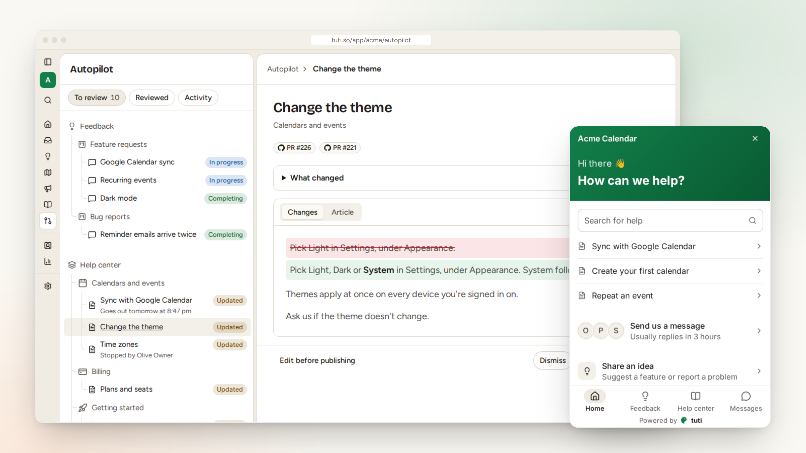
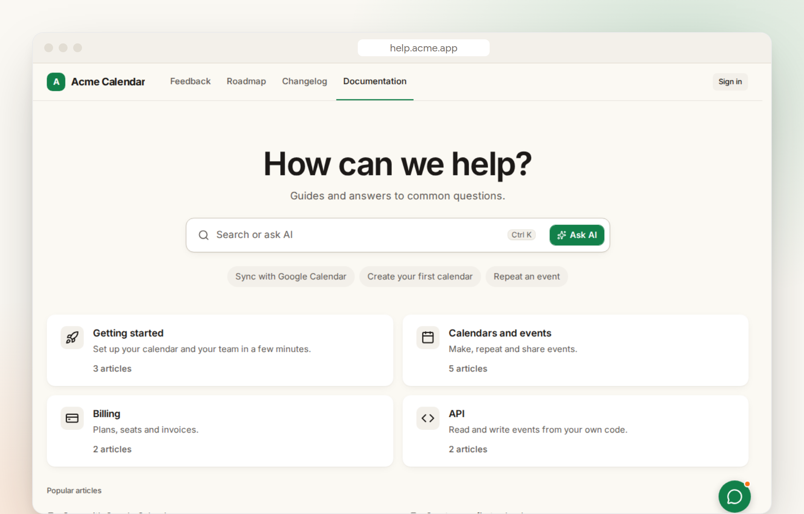
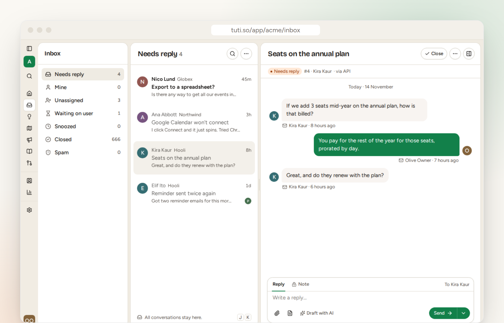
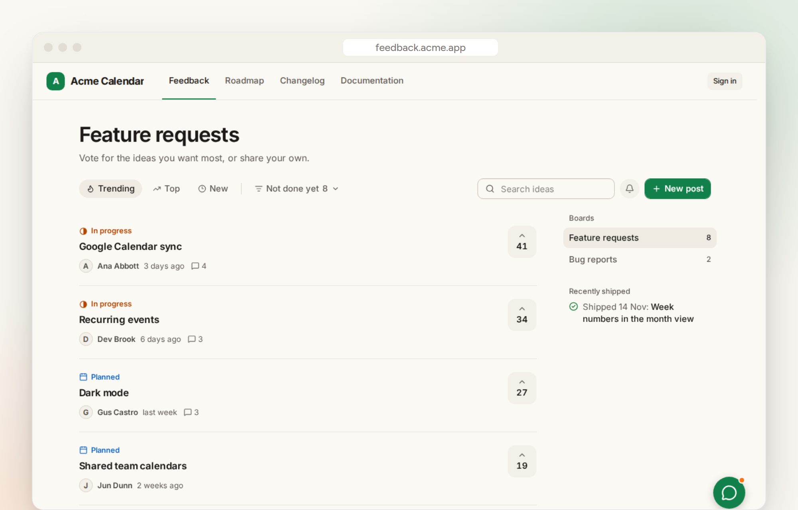
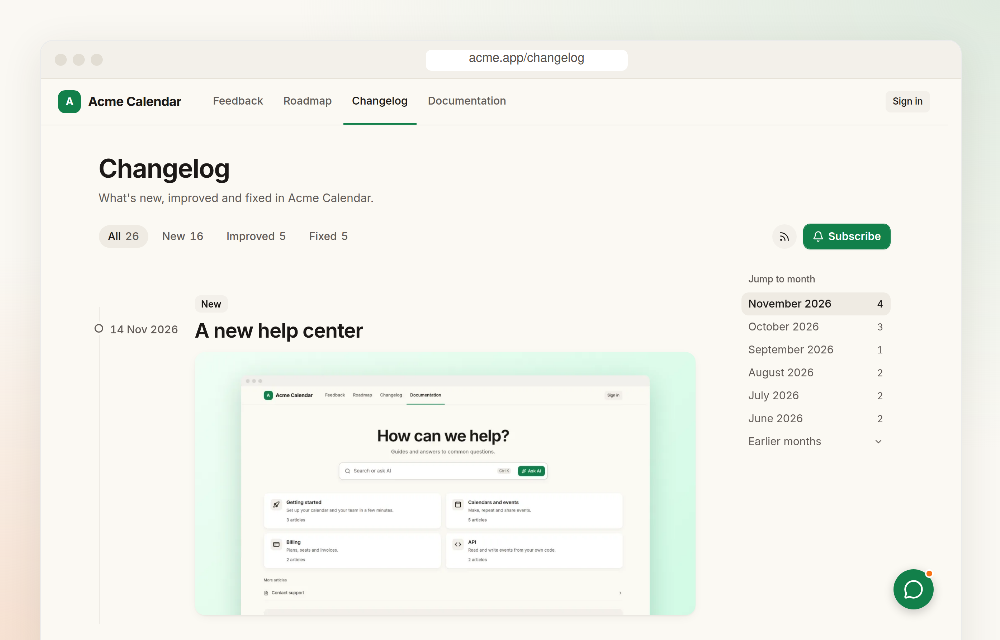
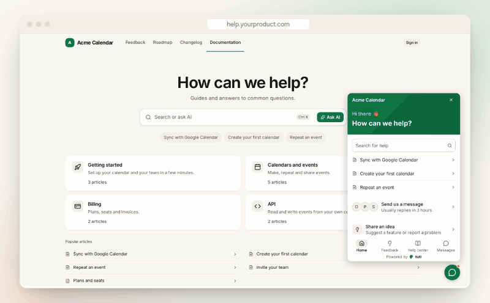

  

<h1 align="center">Tuti</h1>

  <b>Your help center keeps up.</b> 
  Help center, inbox, feedback board and changelog, updated every time you ship.

  <a href="https://tuti.so"><b>Website</b></a> ·
  <a href="https://tuti.so/app/auth/sign-up"><b>Try it free</b></a> ·
  <a href="https://tuti.so/help"><b>Docs</b></a> ·
  <a href="#-star-tuti"><b>⭐ Star us</b></a>

  <picture>
    <source media="(prefers-color-scheme: dark)" srcset=".github/assets/hero-dark.png">
    
  </picture>

> [!TIP]
> **Like where this is going?** Star the repo ⭐. It helps other teams find Tuti, and it tells us to keep going.

## You ship code. Tuti does the rest.

Most help centers are out of date the day after a release. Tuti reads every pull request you merge and works out what it changed for your customers. It fixes the help articles the change made wrong, writes the update for everyone who asked for the feature, and drafts the changelog entry. You read it over, click approve, and everything your customers see is up to date.

  

## One place for every customer question

Four tools that usually live in four tabs, built to work together. A question in the inbox becomes a feature request. A shipped feature closes the request, tells its voters and lands in the changelog.

<table>
  <tr>
    <td width="50%" valign="top">
      <h3>📚 Help center</h3>
      Docs your customers can actually find, with AI answers drawn from your own articles.
        
    </td>
    <td width="50%" valign="top">
      <h3>💬 Inbox</h3>
      Every conversation from the widget and email in one inbox, with replies drafted by AI.
        
    </td>
  </tr>
  <tr>
    <td width="50%" valign="top">
      <h3>💡 Feedback &amp; roadmap</h3>
      Let customers vote on what you build next, with duplicates spotted for you.
        
    </td>
    <td width="50%" valign="top">
      <h3>📣 Changelog</h3>
      Show off what you ship. Subscribers hear about it, and voters hear when their idea lands.
        
    </td>
  </tr>
</table>

All of it also lives in **one widget** inside your app: search help, send a message, share an idea, see what's new.

## Looks like your product, not ours

Your name, colour and fonts, light or dark. The widget matches too, down to its greeting.

  

## Why teams pick Tuti

- **Docs that stay true.** Articles are checked against your code, so what you ship and what you say match.
- **Answers, not search results.** AI answers come from your own help center, in the widget and on the site.
- **Bring everything with you.** Import from Intercom, Featurebase, Canny and more, or bring any public help center by its address.
- **Built for your agents too.** Your help center, inbox, feedback and changelog are all in its REST API and MCP server.
- **Open source.** Read every line, suggest changes, or run it on your own servers.

## Get started

- **Use it now:** sign up at [tuti.so](https://tuti.so).
- **Learn how it works:** guides at [tuti.so/help](https://tuti.so/help).
- **Run it yourself:** see [docs/self-hosting.md](docs/self-hosting.md).
- **Help build it:** see [CONTRIBUTING.md](CONTRIBUTING.md). Found a security issue? See [SECURITY.md](SECURITY.md).

## ⭐ Star Tuti

  If Tuti saves you from one stale help article, give it a star. 
  It's the easiest way to help other teams find it.
    
  

---

  Open source under <a href="LICENSE">AGPL-3.0</a> with <a href="ADDITIONAL-TERMS.md">additional terms</a>. Embeddable SDKs (when they exist) will be MIT. Made with 🦜 by the Tuti team.

